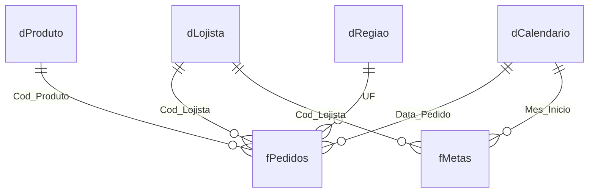

# Modelo estrela — TechShop Brasil

## Grão e função das tabelas

- `fPedidos` (fato): **474** registros válidos; na simulação, cada pedido tem somente uma linha/item. `Pedido_ID` é único.
- `dProduto` (dimensão): **24** produtos; chave `Cod_Produto`.
- `dLojista` (dimensão): **3** lojistas; chave `Cod_Lojista`.
- `dRegiao` (dimensão): **7** UFs; chave `UF`.
- `dCalendario` (dimensão): **181** dias contínuos; chave `Data`.
- `fMetas` (segunda fato): **18** combinações de lojista × mês, com limites máximos de cancelamento e devolução.
- `Rejeitados` (auditoria): **33** registros excluídos do modelo de análise; contagem apenas, sem relacionamentos.

## Diagrama (Mermaid)

## Seis relacionamentos presentes no Power Pivot

| Fato (muitos) | Chave FK | Dimensão (um) | Chave PK |
|---|---|---|---|
| fPedidos | Cod_Lojista | dLojista | Cod_Lojista |
| fPedidos | Cod_Produto | dProduto | Cod_Produto |
| fPedidos | UF | dRegiao | UF |
| fPedidos | Data_Pedido | dCalendario | Data |
| fMetas | Cod_Lojista | dLojista | Cod_Lojista |
| fMetas | Mes_Inicio | dCalendario | Data |

A tabela calendário deve ser marcada como tabela de datas (`dCalendario[Data]`). O relacionamento `fMetas[Mes_Inicio] → dCalendario[Data]` só encontra o primeiro dia de cada mês; em visões por **dia**, metas não se distribuem automaticamente pelo mês. Para comparações mensais, use filtro de `dCalendario[AnoMes]` ou as medidas de comparação apropriadas.

## Check de integridade da simulação

- Não há chaves de produto, lojista ou UF sem cadastro nos pedidos aceitos.
- `dProduto[Cod_Produto]`, `dLojista[Cod_Lojista]`, `dRegiao[UF]`, `dCalendario[Data]` são únicos.
- `fMetas` tem chave composta lógica (`Cod_Lojista`, `Mes_Inicio`).
- Valores/linhas das etapas 2 e 3 devem coincidir exatamente.

**Nota:** o modelo conceitual corresponde ao Modelo de Dados nativo incorporado ao `TechShop_03_PowerPivot.xlsx`. As relações e medidas devem ser conferidas no Excel Desktop antes de uma nova apresentação ou atualização.
